# Отчёт. Домашняя работа 5

Студент: Корольков Артём  
Сайт: «Домашние рецепты»  
Папка: `homeworks/Korolkov_Artem/hw_5`  
Дата проверки: 16 ноября 2026

Название работы: «Изучение основ работы с менеджером зависимостей npm и запуск проекта на Vue.js».

## 1. Цель работы

Научиться пользоваться npm и запустить отдельный небольшой проект на Vue.js. Существующий сайт при этом не переписывался.

## 2. Используемые технологии

- Node.js `v24.14.1`
- npm `11.11.0`
- Vue.js `3.5.45`
- Vite `8.3.8`
- `@vitejs/plugin-vue` `6.0.11`
- Компоненты написаны через Options API: `data`, `computed`, `methods`, `props`

Старый сайт по-прежнему использует JSON Server `0.17.4` и JSON Server Auth `2.1.0`. Эти пакеты стоят в `package.json` папки `hw_5`, а не внутри Vue-проекта.

## 3. Node.js и npm

Проверено в терминале:

```text
node --version
v24.14.1

npm --version
11.11.0
```

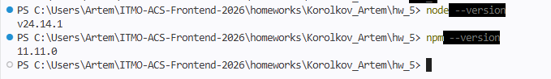

В методичке как пример LTS указаны Node.js `20.17.0` и npm `10.8.2`. Это версии на момент написания методички. Сейчас установлен более новый Node.js. Актуальный `create-vue` `3.24.0` требует Node.js `^22.18.0` или `>=24.12.0`. Установленная версия `24.14.1` этому требованию подходит.

## 4. Как создавался Vue-проект

Методичка предлагает такие шаги:

1. `npm install -g @vue/cli`
2. `npm init vue@latest`
3. В вопросах CLI выбрать нужные опции
4. `npm install`
5. В `package.json` добавить скрипт `start` на порт `8080`
6. Запустить `npm start` и открыть http://localhost:8080

Глобальный пакет `@vue/cli` не устанавливался. Команда из методички `npm init vue@latest` сама скачивает инструмент `create-vue` и не требует отдельной глобальной установки. Vue CLI и `vue create` в этой работе не использовались: методичка после упоминания CLI сразу создаёт проект командой `npm init vue@latest`, а это Vite.

Выполненная команда из папки `hw_5`:

```powershell
npm init vue@latest vue-homework-5 -- --default
```

Она создала каркас через `create-vue` `3.24.0`. У этой версии флаг `--default` включает TypeScript. В методичке на вопрос «Add TypeScript?» нужно ответить No, а примеры написаны на обычном JavaScript (`main.js`, `data()`). Поэтому TypeScript-каркас был убран до `npm install`, и проект оставлен на JavaScript-шаблоне того же `create-vue`: без TypeScript, JSX, Vue Router, Pinia, Vitest, Cypress, Playwright, ESLint и Prettier.

Дальше в `vue-homework-5` выполнено:

```powershell
npm install
```

Установлено 35 пакетов, уязвимостей в Vue-проекте не найдено.

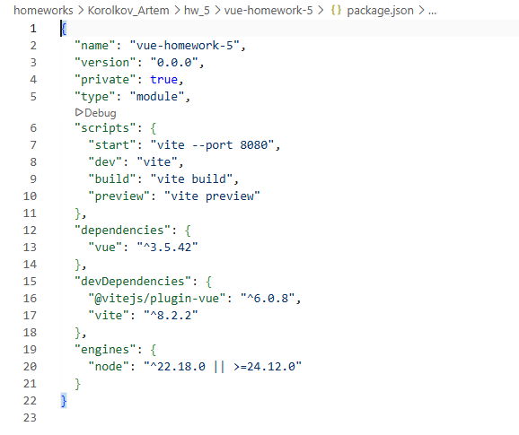

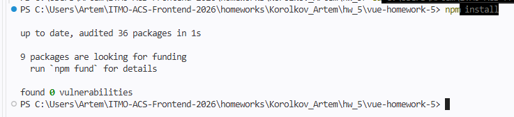

В `scripts` добавлен запуск из методички:

```json
"start": "vite --port 8080"
```

Скрипт `lint` из примера методички не добавлялся: ESLint не выбирался, и такая команда не заработала бы.

Пакеты из следующей части методички (`axios`, `pinia-persists`, `bootstrap`) не ставились. Домашняя работа 5 не требует API, хранилища и переноса всего сайта.


## 5. Основные команды npm

Коротко, что нужно уметь объяснить:

- `package.json` описывает проект и команды запуска.
- `package-lock.json` фиксирует точные версии установленных пакетов.
- `node_modules` — папка со скачанными пакетами. Её не коммитят.
- `dependencies` нужны приложению при работе. Здесь это `vue`.
- `devDependencies` нужны только при разработке и сборке. Здесь это `vite` и `@vitejs/plugin-vue`.
- `npm install` ставит пакеты из `package.json`.
- `npm start` и `npm run dev` запускают проект, а не устанавливают его.

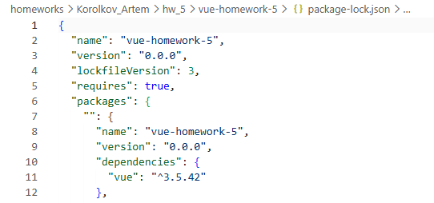


## 6. Структура проекта

Старый сайт остался в `hw_5`: страницы HTML, `assets`, `server`, свой `package.json`.

Новое приложение:

```text
hw_5/
├── index.html, login.html, register.html, search.html, profile.html, recipe.html
├── assets/
├── server/
├── package.json
├── vue-homework-5/
│   ├── package.json
│   ├── package-lock.json
│   ├── index.html
│   ├── vite.config.js
│   ├── src/main.js
│   ├── src/App.vue
│   └── src/components/
│       ├── SiteHeader.vue
│       ├── RecipeCard.vue
│       └── RecipeList.vue
└── homework-5-report/
```

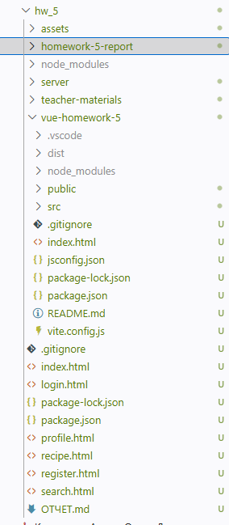

## 7. Что получилось во Vue-приложении

Одна страница «Домашние рецепты»:

- шапка с названием и ссылками «Главная» и «Рецепты»;
- короткий приветственный блок;
- три карточки: сырники, борщ и шарлотка;
- у каждой карточки есть фото, название, описание и время приготовления;
- кнопка «В избранное» меняет подпись на «В избранном» и увеличивает счётчик.

Данные лежат прямо в `App.vue`. Open-Meteo, JSON Server и авторизация к этому приложению не подключались.


## 8. Компоненты

| Компонент | Зачем нужен |
| --- | --- |
| `App.vue` | Хранит три рецепта, считает избранное и собирает страницу |
| `SiteHeader.vue` | Шапка и простая навигация по якорям |
| `RecipeList.vue` | Получает массив и рисует карточку для каждого рецепта через `v-for` |
| `RecipeCard.vue` | Показывает одно блюдо и по клику сообщает родителю id рецепта |

Связь такая: `App` передаёт массив в `RecipeList` через props. `RecipeList` передаёт один рецепт в `RecipeCard`. Карточка делает `$emit('toggle-favorite')`, список передаёт событие выше, а метод `toggleFavorite` в `App` меняет `favorite`.

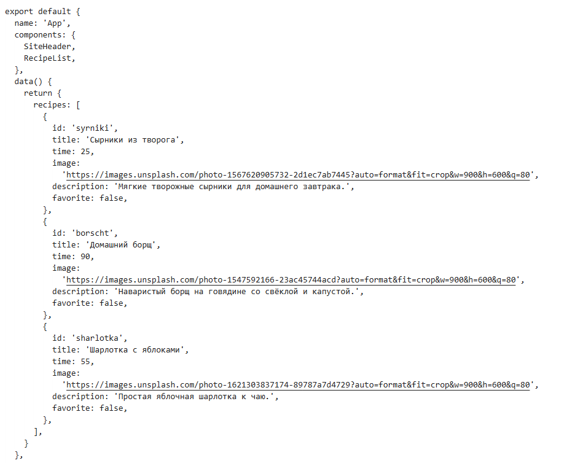

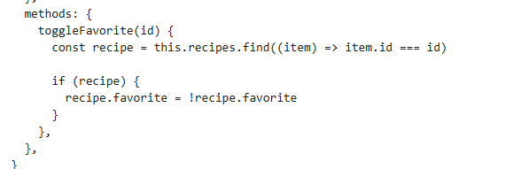

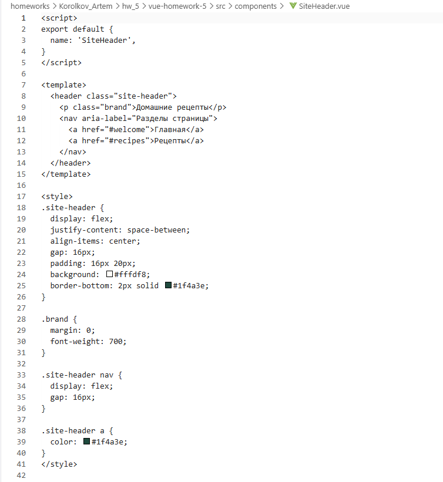

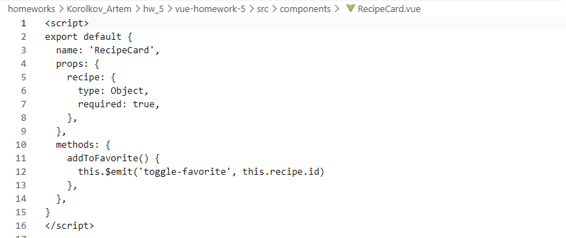

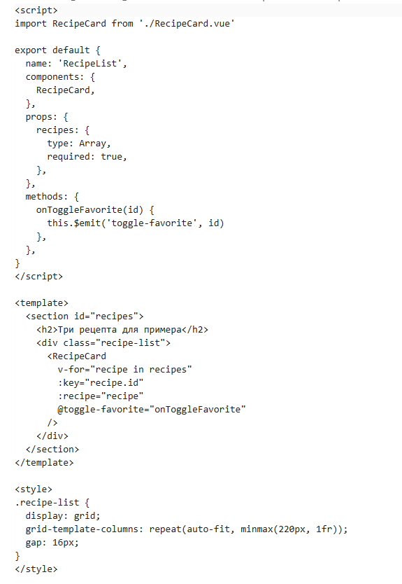

## 9. Проверка

Проверено фактически:

1. Node.js `v24.14.1` и npm `11.11.0` установлены.
2. Папка `vue-homework-5` создана.
3. В ней есть свой `package.json` и `package-lock.json`.
4. `npm install` поставил зависимости.
5. `npm start` открыл http://localhost:8080/. В терминале было: `VITE v8.3.8 ready`.
6. В браузере видны шапка, приветствие и три карточки.

   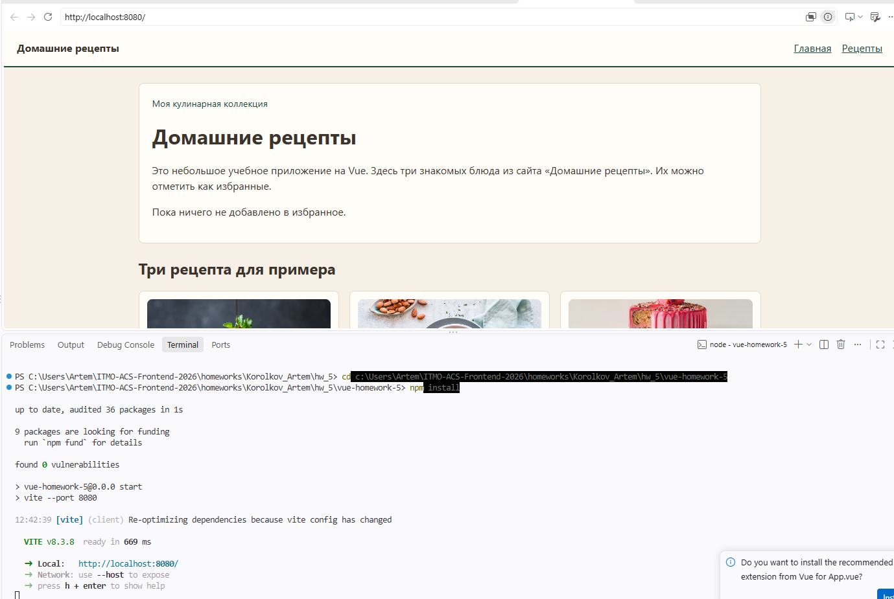

7. Кнопка у сырников сменила текст на «В избранном», над списком появилось «В избранном: 1». Ошибок в консоли браузера не было.
8. `npm run build` завершился успешно. Vite собрал `dist/index.html`, CSS и JS.

   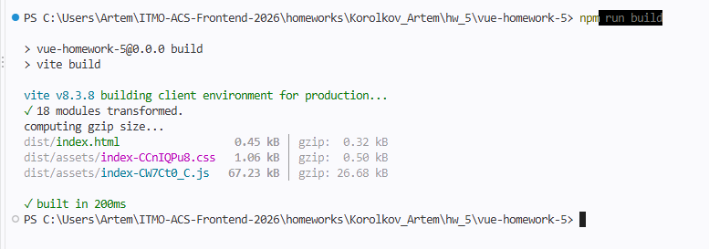
9. Старый `package.json` сайта не заменялся. Команда `npm run start:api` из папки `hw_5` запустила JSON Server на порту 3000. `http://localhost:3000/recipes` вернул 12 рецептов.

Отдельно не запускались: `npm run dev`, `npm run preview`, `npm uninstall`, установка случайного пакета.


## 10. Вывод

Отдельный Vue-проект запускается через npm и Vite, не ломая прежний сайт. На этом примере видно, зачем нужны `package.json`, `package-lock.json` и `node_modules`, как устроен компонент Vue и как данные передаются от родителя к карточке рецепта.
