Скриншоты

<h2>1. Версии Node.js и npm</h2>

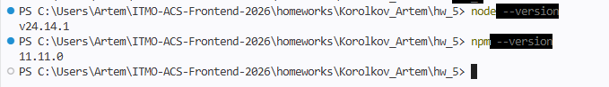

<h2>2. Создание Vue-проекта</h2>

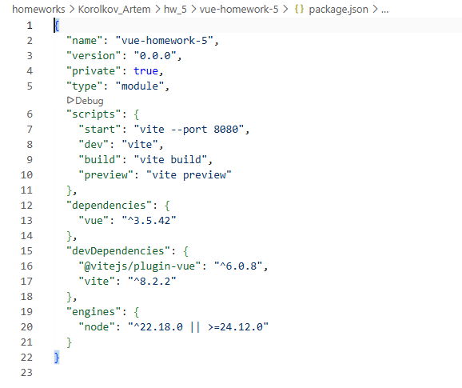

<h2>3. npm install</h2>

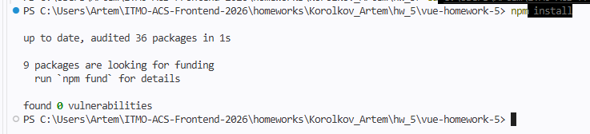

<h2>4.  package-lock.json</h2>

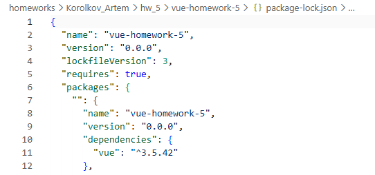

<h2>5. Структура в Explorer</h2>

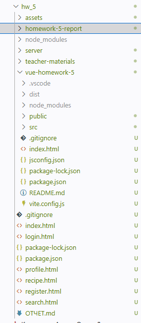

<h2>6. App.vue - данные и обработчик живут в главном компоненте</h2>

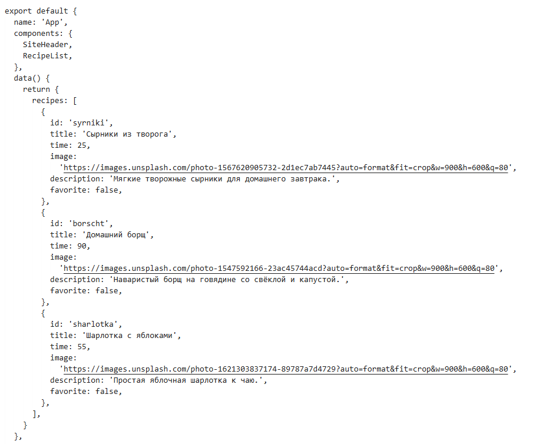
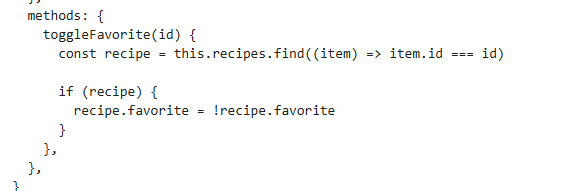

<h2>7. SiteHeader.vue - шапка вынесена в отдельный компонент</h2>

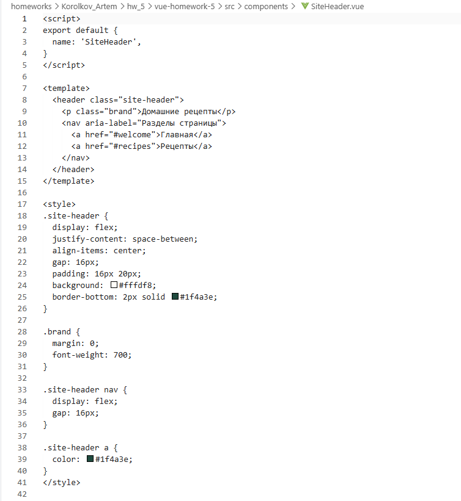

<h2>8. RecipeCard.vue - карточка получает данные снаружи и сообщает о клике</h2>

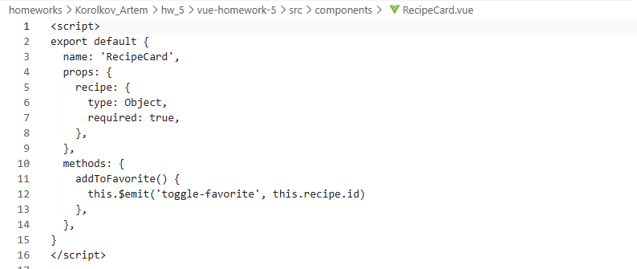

<h2>9. RecipeList.vue - писок рисует карточку для каждого рецепта</h2>

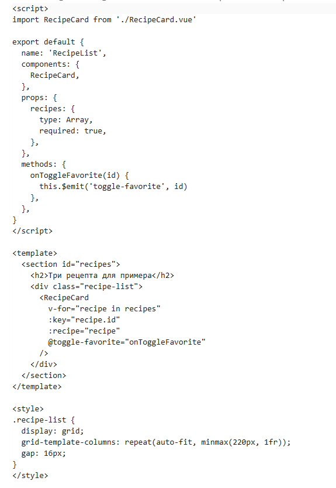

<h2>10.  Приложение в браузере</h2>

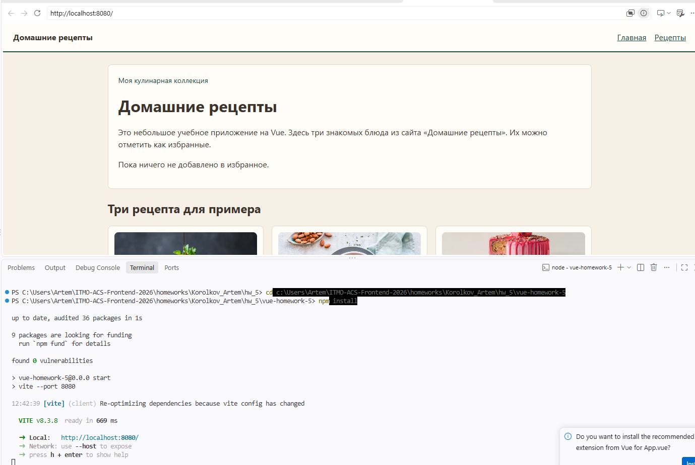

<h2>11. Production build</h2>

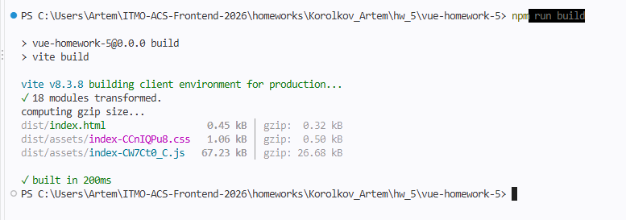